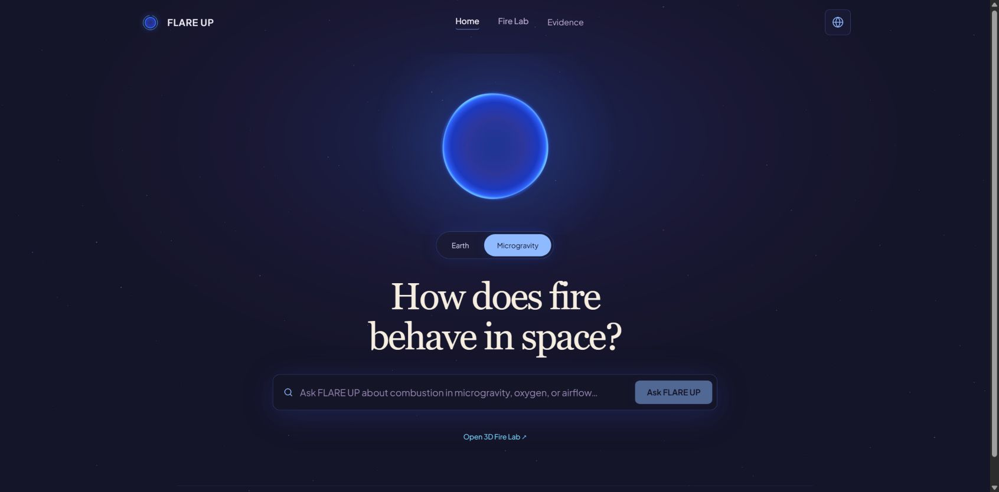

# FLARE UP

### Flame in Freefall

**Explore fire beyond Earth. Follow every answer back to the evidence.**

FLARE UP transforms NASA microgravity combustion research into an interactive experience for students, researchers, and curious explorers. Ask a question, inspect reported measurements, and explore how gravity and environmental conditions relate to fire research—without losing the sources or the uncertainty behind the answer.

[**Explore the live experience →**](https://flare-up-ranad0.netlify.app/) · [Full-app mirror](https://flare-up-ranad0.onrender.com/) · [NASA Space Apps challenge](https://www.spaceappschallenge.org/2026/challenges/flame-in-freefall/)

## Why FLARE UP?

Understanding fire aboard spacecraft means asking questions that everyday experience cannot fully answer. How does ventilation affect flame spread? What can smoke experiments tell us about detection? Which observations support a comparison—and which conditions differ?

NASA's Physical Sciences Informatics (PSI) repository holds the research. FLARE UP makes that evidence easier to find, compare, and understand through a focused search experience and an interactive Fire Lab.

## Explore, ask, investigate

- **Ask FLARE UP.** Read a concise answer first, then expand the supporting passages, measurements, and citations.
- **Compare reported measurements.** Inspect original values, units, experimental conditions, and source rows. Text, quantitative, and hybrid questions follow distinct retrieval paths.
- **Enter the Fire Lab.** Explore gravity, oxygen, pressure, airflow, and sample controls alongside related NASA investigations and clearly stated evidence gaps.
- **Follow the evidence.** Open investigation records, examine source locations, and explore NASA challenge resources in a separate contextual collection.
- **Experience two visual worlds.** Earth and microgravity modes coordinate the flame, surrounding atmosphere, logo, and cursor response. English and Arabic navigation are available through the globe control.

> Evidence-informed visualization — not a numerical combustion simulation.

## NASA data is the foundation

The active research corpus covers **19 verified NASA Combustion Science Microgravity Investigations**, including BASS/BASS-II, FLEX, Saffire, SAME/SAME-R, and ACME investigations.

| Evidence in the current release | Coverage |
|---|---:|
| Active PSI source files | 41 |
| Original experimental CSV tables | 21 |
| Structured source rows | 2,001 |
| Scalar numeric records | 12,160 |
| Selected text passages | 113 |
| Separate NASA supporting resources | 10 entries / 122 passages |

Scalar records include experimental conditions and reported observations; they are not separate experiments. The text collection contains 61 official investigation metadata passages and 52 reviewed PDF passages, with objectives, hypotheses, methods, and findings labelled distinctly. Coverage is selective, not complete ingestion of NASA PSI or of every investigation.

Each admitted record retains source traceability: investigation identity, source URL, DOI where available, original filename, page or row location, and file hash. Ground investigations—including PSI-117—and pending-review extractions are excluded from default judged retrieval. Unknown units remain unknown. Historical safety cases and educational resources remain separate from experimental measurements.

[Explore NASA PSI](https://psi.nasa.gov/physci/repo/search?q=combustion&data_source=psi&data_type=investigation) · [Read our provenance and eligibility policy](backend/data/meta/DATA_PROVENANCE.md) · [Latest data audit](docs/HANDOFF_3_REPORT.md)

## AI with an evidence trail

FLARE UP routes questions to text retrieval, structured records, or both. Local lexical and latent-semantic search retrieves the evidence before an optional **Groq-hosted `openai/gpt-oss-20b`** layer produces a concise qualitative answer.

Supporting quotations are selected from source passages, citations are checked, and a separate entailment review checks the proposed claims. Numerical summaries are formatted from structured records rather than generated by the model. Answers distinguish **Reported by Sources**, **Interpretation**, **Not Established**, and **Sources**.

If inference is unavailable or an answer fails its checks, FLARE UP returns an explicit extractive fallback. Automated checks reduce errors; they do not replace scientific review. No direct OpenAI API is used.

## A short tour

1. Switch **Earth ↔ Microgravity** and move your cursor near the flame.
2. Ask: *How does cabin airflow influence flame spread in spacecraft?*
3. Compare: *Compare burn time for normal and inverse flames in PSI-159.*
4. Combine evidence: *Compare burn time PSI-159 at 1.1 bar and explain the experiment.*
5. Open **Fire Lab**, adjust a condition, and select **Analyze NASA Evidence**. Inspect what is reported and what remains unestablished.

The public service uses free hosting and may need a short wake-up period after inactivity.

## Built for Flame in Freefall

FLARE UP addresses the NASA Space Apps challenge through accessible investigation discovery, traceable comparisons, evidence-grounded explanations, and an interactive scientific exhibit. Its intended impact is to make spacecraft fire research more understandable and easier to interrogate—not to issue operational safety advice.

[Seven-slide presentation and demo](docs/DEMO_SCRIPT.md) · [Challenge alignment](docs/JUDGING_MAP.md) · [Architecture](docs/ARCHITECTURE.md) · [Validation](docs/HANDOFF_3_VALIDATION.json)

## Team & contributors

Built collaboratively by:

- [@ranad0](https://github.com/ranad0)
- [@batoolmahashi](https://github.com/batoolmahashi)
- [@shathaarar](https://github.com/shathaarar)
- [@bushraahmaed005-hue](https://github.com/bushraahmaed005-hue)
- [@halabdeir](https://github.com/halabdeir)

## Project documentation

[Local setup and development](docs/LOCAL_DEVELOPMENT.md) · [Deployment](DEPLOYMENT.md) · [API explorer](https://flare-up-ranad0.onrender.com/docs) · [Source and asset notices](NOTICE.md)

FLARE UP is an independent NASA Space Apps project. It is not an official NASA product or an operational fire-safety system.
